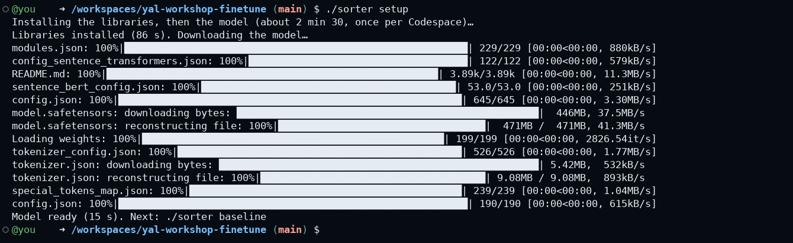
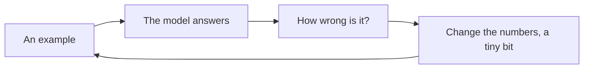
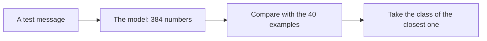
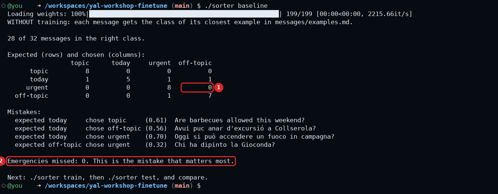
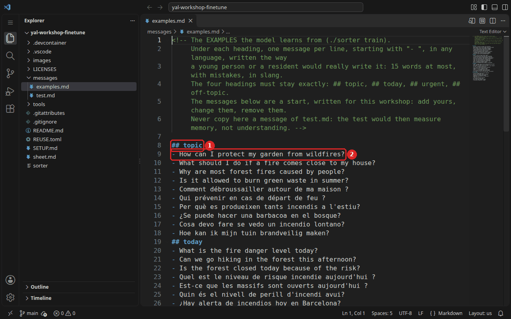
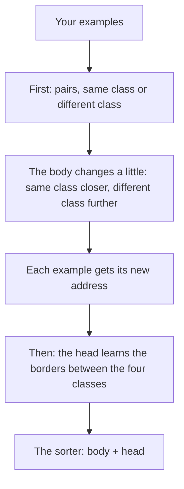
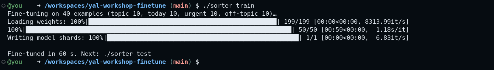
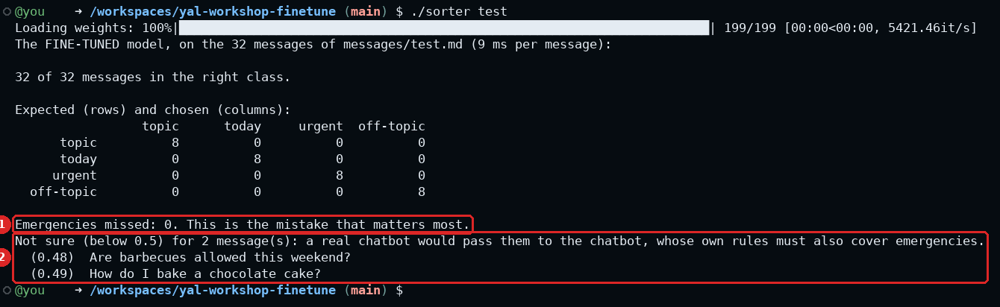
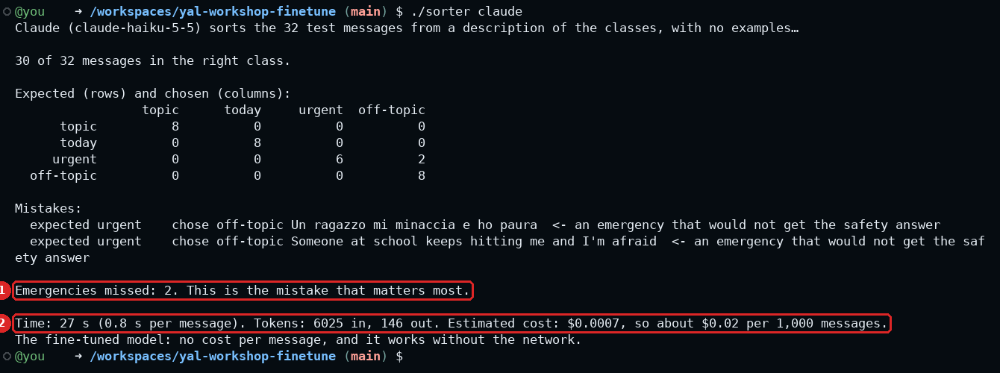
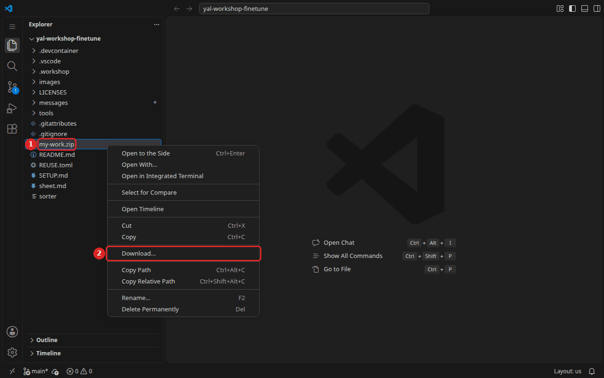

# Workshop 6 - Teach a small model to sort messages

### Youth AI Lab (Erasmus+) - series "Build your own chatbot", workshop 6 of 6

- **Project:** Youth AI Lab (Erasmus+), with five partners: L.A.B. (Aix-en-Provence, France),
  UAB (Barcelona, Spain), Perlatecnica (Naples, Italy), Digitale Wolven (Antwerp, Belgium),
  CSC Vent des Îles (La Rochelle, France).
- **The series:** [the workshops](https://github.com/Youth-AI-Lab/yal-workshop-kit#the-series)
- **Need help?**
  - Raise your hand and ask the facilitator.
  - If something breaks, don't panic: your files stay in the Codespace.

> 🎓 **Open your Codespace** (one per pair): 👉 **https://codespaces.new/Youth-AI-Lab/yal-workshop-finetune**
>
> **Before you click**, if the idle timeout of this GitHub account is not set yet: do
> [step 1 of SETUP.md](SETUP.md#step-1---let-the-codespace-wait-for-you) (1 minute).
>
> This link creates your own copy of this repository, in VS Code running in your browser. Nothing
> to install. The detailed steps are in [Part 1](#part-1---welcome-15-min).

> 📚 **The slides of the facilitator:** https://youth-ai-lab.github.io/yal-workshop/6/ (the same
> words as this page). **The short version** of this page, on one page: [sheet.md](sheet.md). The
> setup and the common problems of the whole series: [SETUP.md](SETUP.md).

### Contents

- [Goals of the session](#goals-of-the-session)
- [Part 1 - Welcome (15 min)](#part-1---welcome-15-min)
- [Part 2 - A model that has not learned your classes yet (★, 15 min)](#part-2---a-model-that-has-not-learned-your-classes-yet--15-min)
- [Part 3 - Write your examples, and a test for another pair (★★, 25 min)](#part-3---write-your-examples-and-a-test-for-another-pair--25-min)
- [Part 4 - Fine-tune, test, improve (★★, 30 min)](#part-4---fine-tune-test-improve--30-min)
- [Part 5 - The big model, without training (★★★, 15 min)](#part-5---the-big-model-without-training--15-min)
- [Part 6 - Closing (15 min)](#part-6---closing-15-min)
- [Troubleshooting](#troubleshooting)

---

## Goals of the session

### What you will be able to do by the end of this session

In workshops 1 to 5, you gave the chatbot instructions, knowledge, a way to search, tools and a
wiki. All of it entered the **context**: text that the model reads before it answers. The model
itself never changed. It stayed the same model for everyone, with the same numbers inside. Today,
you change a model. A small one, for one narrow task: **sorting the messages** that people send to a
chatbot, before the chatbot sees them. The question of the day is:

> **When is it worth teaching a small model, instead of asking a big one?**

| Bloom level | Parts | You will be able to... |
|---|---|---|
| **Understand** | 1, 2, 4 | Explain what a classifier does, what training changes inside a model, and why a model that chooses cannot invent an answer. |
| **Apply** | 3, 4 | Write examples and a test in your language, fine-tune a model on them, and test it. |
| **Analyse** | 2, 4 | Read a confusion table, and find the mistake that matters most. |
| **Evaluate** | 5, 6 | Compare your small model with a big one (right answers, speed, cost, what leaves the Codespace), and decide when fine-tuning is worth it. |

### Why this approach?

**Fine-tuning** means changing a model a little, with your own examples, so that it gets better at
one task. In workshop 5, it was only an option on a slide of the facilitator: the knowledge goes into
the model, with no source, and a mistake means training again. A fine-tuned model that writes can also
still invent, and fine-tuning a big one takes far more than a youth organisation has: graphics cards,
thousands of examples, days of work.

A **classifier** is a different kind of model. It does not write anything. It **chooses** one class
among a few that you decide, so it cannot invent an answer. A small classifier learns from a few
dozen examples, in one or two minutes, on the two processors of your Codespace, with no graphics
card. This is fine-tuning at a size you can do yourself, watch, and test in one session.

The task of the day is a real one. A chatbot receives four kinds of messages, and they do not all
deserve the same treatment:

| Class | What it means | Example | What should happen |
|---|---|---|---|
| `topic` | a question about the chatbot's topic | "How can I protect my garden from wildfires?" | the chatbot answers, with its instructions and knowledge |
| `today` | a question that needs the facts of the moment, tonight or this weekend included | "What is the fire danger level today?" | the chatbot answers with the live tool of the day (official source: workshop 4) |
| `urgent` | a fire happening now, or a person in danger or distress, with no fire needed | "There is smoke coming from the woods behind my house!" | a fixed safety answer, at once |
| `off-topic` | anything else | "Can you help me with my maths homework?" | a polite refusal that still says who can help (the emergency number, an adult they trust), without spending tokens |

A sorter placed **before** a chatbot could do this in under a second, at no cost per message, and
sorting sends the message nowhere.

The question of the series was: **what enters the model's context, when, and who decides?** Today's
answer: a small model can decide whether a message reaches the big model at all, and you decide, with
your examples, how it sorts.

### How this connects to WikiYouthBot

**Feurisson, the chatbot of the young people of La Rochelle**, uses the same idea in its prototype: a
small French model (CamemBERT), fine-tuned on the cards of its FAQ, picks the card that answers a
question, or none, before Claude is called. The young people will write the cards and the examples
(the activity has not been run with the group yet). A FAQ answer is free and always the same. Its
emergencies are caught by fixed expressions, not by a model, and only the cards marked as checked
are shown to the public. See
[wikiyouthbot-feurisson](https://github.com/Youth-AI-Lab/wikiyouthbot-feurisson) (in French) and its
activity with young people.

**Part 3** is an activity in itself with young people: writing the messages that a chatbot will
receive, in their own words, is a way to think about who will use it and how. The messages are
invented, never taken from anyone's life, and your organisation first agrees on who handles a worrying
message. **Part 5** is a question to ask before choosing a tool: what does each message cost, and where
does it go?

The series, one piece of the chatbot at a time:

- **Workshop 1**: the instructions, and how to test a chatbot
- **Workshop 2**: all the knowledge in the context, then a RAG
- **Workshop 3**: the model searches by itself, and skills
- **Workshop 4**: tools that bring today's facts
- **Workshop 5**: organise what it knows in a wiki, and pack the chatbot of your territory
- **Workshop 6** (this one): **fine-tune a small model**, to sort messages before the chatbot

### Before you start

**Nothing to bring from the earlier workshops**: this one stands on its own. **Think of how young
people write** to a chatbot in your language, with what words, what mistakes? You will invent messages
like theirs in Part 3.

From [SETUP.md](SETUP.md), you need steps 1 to 3 and step 6 today. This workshop has no chatbot, so
you skip steps 4 and 5.

### Reference documents

All of these are in your Codespace, in the file list on the left:

- `messages/examples.md`: the examples the model learns from, under four headings. You write here
  today.
- `messages/test.md`: the test messages. The model never sees them while it learns.
- `sorter`: the command of the day (type `./sorter` to see what it can do).
- `tools/sorter.py`: the program behind it, about 500 lines of Python, if you are curious.
- `SETUP.md`: setup and common problems of the whole series.

---

## Part 1 - Welcome (15 min)

> **Goal**: open your Codespace, install the sorter, and understand what a model is made of and what
> training means. Everything else today builds on these two ideas.

### Step 1 - Open your Codespace and save your key

1. Open the link at the top of this page, then **Create codespace**. Wait for the terminal.
2. In the terminal, save your key (once per Codespace):

   ```bash
   workshop-login
   ```

   Paste your key, press Enter. **What you should see:** a line that starts with `Key OK` and ends
   with `You can start: workshop-start 6`. This makes one small request to Claude Sonnet, or to
   DeepSeek V4 Flash with an OpenRouter key. After that, only Part 5 uses the key: Claude Haiku with
   an Anthropic key (it starts with `sk-ant-`), Mistral Small with an OpenRouter key (it starts with
   `sk-or-`). If your key fails, tell the facilitator and go on: Parts 1 to 4 do not need it.
3. Get ready for today:

   ```bash
   workshop-start 6
   ```

   **What you should see:** `Ready for workshop 6.`, then `First command: ./sorter setup`.

> ℹ️ **No Codespace?** The same repository opens on your own computer, with Docker and VS Code: see
> the [dev containers guide](https://github.com/Youth-AI-Lab/yal-devcontainer-guide).

### Step 2 - Install the sorter

The libraries that fine-tune a model are big (about 2 GB with the model). They are not in the
Codespace from the start: you install them now, once.

1. Type:

   ```bash
   ./sorter setup
   ```

2. While it installs, listen to the facilitator, who presents the next two sections. You can read
   them later.

**What you should see:** within about 2 min 30 (92 to 151 s in our tests, in real Codespaces and in a
copy with 2 processors), `Libraries installed (… s)`, then `Model ready (… s). Next: ./sorter baseline`.
Each line counts its own step.



### What is a model, and what does training mean?

A **model** is a program whose behaviour is not written as rules. It is stored as a very long list
of numbers, called **parameters**. The small model of today has 117,653,760 of them. Nobody chose
these numbers one by one. They were found by **training**, and training always follows the same
loop: the program receives an example, gives its answer, measures how far that answer is from the
right one, then changes its numbers a tiny bit, in the direction that makes the mistake smaller.
Then it starts again with the next example.



After many rounds, the numbers hold what the examples have in common. **Fine-tuning** is the same
loop, started from a model that is already trained, with few examples and small changes.

**Key insight:** instructions, documents and tools change what a model **reads**. Training changes
what a model **is**. Text in the context can be read, quoted, corrected or removed. You cannot do that
with what enters the numbers: you will come back to this in Part 5.

### What is this small model?

The model of the day is `paraphrase-multilingual-MiniLM-L12-v2`, published by the authors of the
sentence-transformers library, under the Apache 2.0 licence. It knows about 50 languages, among
them English, French, Spanish, Catalan, Italian and Dutch. Its name says what it was made for: a
paraphrase is the same idea in other words. Its page does not say which texts it was trained on.

It does one thing: it turns a sentence into a list of 384 numbers. Think of these numbers as an
address on a map of meaning. An address on a paper map has two numbers; this one has 384, so nobody
can draw the map, but the idea is the same: **two sentences with the same meaning get close
addresses**, whatever their words and their language.

**Closeness** is a score that measures this. Picture each address as an arrow, from the centre of the
map to its place. All the arrows have length 1, so only their direction counts. Closeness is the
**cosine** of the angle between two arrows. To get it, multiply the two lists number by number, then
add up the results. With 2 numbers instead of 384 (made up for the example), the lists 0.6, 0.8 and
0.8, 0.6 give 0.6 × 0.8 + 0.8 × 0.6 = 0.96, an angle of 16°. The same direction gives 1, a right
angle gives 0 (little link), and opposite directions give -1.

Higher means closer for this model: it does not measure shared meaning. Workshop 2 drew the same
arrows, with another small model and another scale, $(1 + \text{closeness}) / 2$, so 0.5 meant no
link there. In our test:

| Sentence | Compared with "Is the forest closed today?" | Closeness | Angle (about) |
|---|---|---|---|
| Its French translation | "La forêt est-elle fermée aujourd'hui ?" | 0.995 | 6° |
| The opposite question | "Is the forest open today?" | 0.86 | 31° |
| Something else | "Can you help me with my maths homework?" | 0.04 | 88° |

The first line shows why one model is enough for all the languages of the room. The second line
shows its limit: the model gives more weight to "forest" and "today" than to "open" or "closed". For sorting,
that does not matter, because both are questions about today. That is all it knows. It knows nothing
about fire safety, and it does not write.

Do not mix up two kinds of numbers. The 117,653,760 parameters are the model itself: they stay the
same from one sentence to the next, and only training changes them. The 384 numbers of the address
are a result: the model computes a new list for each sentence. Training changes the first kind, and
that is why the second kind comes out different.

**Key insight:** you are not building a model today. You start from one that already knows how close
two sentences are, and you teach it something it does not know yet: your four classes.

> 💡 **Tip.** **Checkpoint**: `Key OK` (or the facilitator knows about your key), then `Model ready`.
> And you can say in one sentence what training does to the numbers of a model.

---

## Part 2 - A model that has not learned your classes yet (★, 15 min)

> **Goal**: see what the model does before you train it, and learn to read a confusion table.
> This score, the **baseline score**, is your starting point: without it, you could not say what training brought.

### What you will discover

- A model that only knows "close meanings" already sorts many messages well.
- One number ("28 out of 32") hides which mistakes were made. A table shows them.
- All mistakes are not equal.

### How it sorts without training

`messages/examples.md` holds 40 example messages, 10 per class, in six languages. Without any
training, the sorter computes the address of each example. Then it takes each test message, computes
its address, finds **the closest example**, and gives the test message the class of that example.
Nothing is learned here: it only compares.



**Key insight:** this is the same idea as the RAG of workshop 2, which also looks for what is closest
in meaning. Here, the closest piece does not go into a context: it only gives its class to the message.

### What to do

1. Open `messages/examples.md` and `messages/test.md`, side by side. The test messages are different
   sentences from the examples, in the same six languages.
2. Type:

   ```bash
   ./sorter baseline
   ```

**What you should see**, with the messages as they are in the repository (our test on 2026-10-31):



### Reading the result

The table is called a **confusion table**, because it shows which classes the sorter confuses. Each
row is the right class, each column is what the sorter chose. In the row `today`, 5 messages were
sorted as `today`, and one each went to `topic`, `urgent` and `off-topic`. Everything on the
diagonal is right, and everything else is a mistake.

| What you read | What it says |
|---|---|
| `28 of 32` | The score. It says how many, not which ones. |
| The table | Where the mistakes go. The cell of frame 1 is the most serious one. |
| `Mistakes:` | Each wrong message, with what was expected and what was chosen. The number in brackets is how close the nearest example was. |
| `Emergencies missed:` (frame 2) | The number of emergencies sorted as something else. |

Notice three things in these mistakes. Three of the four are `today` messages. "Are barbecues allowed
this weekend?" is close to the `topic` examples, because it talks about the same things: **close in
meaning does not mean same class.** What makes a message `today` is a small part of its meaning, and
the model gives it no special weight. That is what training will change. Then, look at "Chi ha dipinto
la Gioconda?" (who painted the Mona Lisa?): its closest example is only at 0.32, and it still receives
a class. A classifier always chooses, even when nothing fits. Finally, no emergency is missed here,
but that says nothing yet about your messages.

> ⚠️ **Important.** **The mistake that matters most is an emergency sorted as something else.** A
> message about the weather sorted as `topic` costs a few tokens. "Help, the field next to us is on
> fire" sorted as `off-topic` can get a polite refusal instead of the safety answer. Read this line
> first, every time.

> 💡 **Tip.** **Checkpoint**: you can point, in the table, at the cell of "an emergency sorted as
> off-topic", and say how many messages are in it.

### Think about it

1. Why can a model that has learned no classes still sort "Au feu !" as urgent?
2. Which would you rather have: 30 right out of 32 with one emergency missed, or 28 right with none
   missed?

---

## Part 3 - Write your examples, and a test for another pair (★★, 25 min)

> **Goal**: give the model the examples that will teach it, in your language, and write an honest
> test. This is the real work of the day: the training itself takes one or two minutes, and it can
> only learn what your examples show.

### What you will discover

- The quality of a fine-tuned model comes from its examples, more than from the computer.
- A test is only honest if the model has never seen its messages.
- Hard examples are the ones near a border between two classes.

### What an example is

In workshop 1, you told the chatbot what to do, in sentences. Here, you explain nothing. An example is
a message and the class it belongs to, and the model only learns from what the messages of a class
have in common. The word `urgent` means nothing to it: you could name the class `A`, and it would
learn the same thing. So if all your `urgent` examples talk about fire, the model can learn that
`urgent` means fire, and a young person who writes "someone keeps hitting me" may not be seen as an
emergency. **What your examples leave out, the model does not learn.**

### Discovering the files

Open `messages/examples.md`. The comment at the top repeats the rules. Below it, a heading gives the
class (frame 1), and each line under it is one example of that class (frame 2):



`messages/test.md` has the same form, but it plays another role. There, the heading is the right
answer that the sorter must find, and the model never learns from these lines. The sorter reads
this file only to give you a score.

### Good examples

The model will learn from every line of `messages/examples.md`, so a good set of examples looks like
the messages it will really receive. Write the way a young person or a resident writes, with slang,
mistakes and no punctuation, sometimes one word ("help!!"), sometimes a full sentence. Use different
words, lengths and languages for the same class. Above all, add the **hard cases**, the ones that sit
near a border between two classes: an emergency that contains a question ("there is smoke, what do I
do?"), a person in danger with no fire ("someone is following me"), an off-topic message about fire
("light my birthday candles?"), a `today` question that does not say "today" ("can we barbecue this
weekend?").

One rule for both files: **every message is invented, with nothing about a real person**. In Part 5,
`./sorter compare` sends each test message to Anthropic, or through OpenRouter to a company that runs
the model.

> ℹ️ **Note.** **Keep each message to 15 words at most.** The model gives an address to each [token](https://github.com/Youth-AI-Lab/yal-local-ai-guide/blob/main/how-an-llm-works.md#what-a-token-really-is) (a
> word or a part of a word), then takes the average, so one urgent sentence is drowned in a long
> message. This happens well before the limit of 128 tokens (about 100 words in English), where the
> model stops reading. `./sorter train` warns you about a longer example, and `./sorter test` lists a
> longer test message with no sure emergency. Troubleshooting says what the sorter does with them.

### What to do

1. **Add at least ten messages per class** to `messages/examples.md`, in your language, under the
   four headings. Keep the headings exactly as they are (`## topic`, `## today`, `## urgent`,
   `## off-topic`), and start each message with `- `. Save.
2. **Write a test for another pair**: on paper or in the chat of the session, three messages per
   class, in your language, that the other pair has never seen. Write the class above each group: it
   is the right answer of the test. Give them your messages with their classes, and receive theirs.
3. **Type the messages of the other pair** into `messages/test.md`, under the classes they gave you, in
   place of the starting messages. Save.

Why another pair? You write the examples and you know them, so your own test messages would look
like them. Someone else writes the way real users do, with words you did not expect.

> ⚠️ **Important.** **Check the heading above each line.** `## off-topic` is the last heading, so a
> message typed at the very end of the file lands there. In our test, one fire message left there
> made the model miss 2 emergencies (30 of 32). Under `## urgent`, the same message missed none (31
> of 32). A wrong heading teaches the wrong thing, and nothing warns you.

> ⚠️ **Important.** **The golden rule: a test message never goes into the examples.** Otherwise the
> test measures memory, not understanding. If a test message is also an example, word for word,
> `./sorter baseline`, `./sorter train` and `./sorter test` warn you. A sentence you reworded is not
> caught.

> 💡 **Tip.** **Checkpoint**: `examples.md` has at least 20 messages per class (10 from the start, 10
> of yours), and `test.md` has the messages of another pair. Late when Part 4 starts? Stop writing and
> train with what you have. No test from another pair? Keep the starting test for practice: the hard
> messages of step 8 of Part 4 are then your honest check.

### Think about it

1. Which class was the hardest to write examples for? Why?
2. What message would a young person send that none of your examples looks like?

---

## Part 4 - Fine-tune, test, improve (★★, 30 min)

> **Goal**: fine-tune the model on your examples, understand what changed inside it, see what it
> learned, and make it better.

### What you will discover

- A sorter has two parts, and training changes both, in two different ways.
- Fine-tuning a small model takes one or two minutes, on the processors of the Codespace.
- The training of the body follows one number, the training score, and brings it down over the
  rounds, until a number of rounds fixed in advance.
- A lower training score does not always mean a better sorter.
- The confusion table tells you which examples to write next.
- A second set of examples can improve the model, but it also spoils your test.

### What do you train?

> ℹ️ **Note.** Read this section and the next one with your partner before step 1 of "What to do"
> (about 4 minutes). They explain what `./sorter train` is going to do.

The sorter has two parts. The **body** is the model you met in Part 1, which turns a sentence into 384
numbers. The **head** is a very small model that you add on top of it. It reads these 384 numbers and
gives one value per class. The body knows about language, and training teaches it to bring messages
of the same class closer. The head knows about your four classes.

| | The body | The head |
|---|---|---|
| What it does | Turns a sentence into an address | Turns an address into a class |
| Size | 117,653,760 numbers | 1,540 numbers |
| On disk, after training | `model.safetensors`, about 470 MB | `model_head.pkl`, about 7 KB |
| Before today | Already trained by its authors | Does not exist yet |
| Today | Changed a little | Built from nothing |

### How does the training work?

The method is called **SetFit**, and it works in two steps.



**First, the body, with pairs of messages.** The body gives addresses, not classes, so you cannot ask it "which
class is this?". You can only ask "are these two close?". Pairs turn your examples into that question,
and they turn a few examples into many training rounds. From 40 examples, it makes 800 pairs: 400 of the same class, and 400 of different classes.
For each pair it knows the target: closeness 1 for the same class, 0 for different classes. So training
tries to turn the arrows: the same direction for the same class, a right angle for different classes.
It never asks for opposite directions. With our 40 examples, the two pairs shown further down went from
82° to 59° (same class) and from 58° to 79° (different classes). Training takes
16 pairs at a time, measures how far their closeness is from the target, and changes the numbers of
the body a tiny bit. This is the loop of Part 1. With 800 pairs, 16 at a time, there are **50 rounds**,
the number on the long progress bar. Each example gives 20 pairs, so twice as
many examples take about twice as long.

The 20 is a setting, not a rule: `num_iterations=10` in `tools/sorter.py` asks for 10 × 40 pairs of each
kind. Count on paper: each of the 40 messages meets 39 others, and that counts each pair twice, so
40 × 39 / 2 = 780 different pairs. In a class of 10, it is 10 × 9 / 2 = 45, so 4 × 45 = 180 pairs of the
same class, and SetFit goes round its list again to reach 400. With 80 examples it makes 1,600 pairs, although
3,160 different ones exist. That is why the time only doubles.

**Then, the head, with borders.** Now the addresses are better, and the body stops changing. SetFit
computes the address of each example, then trains the head on these addresses. The head draws the
borders between the four classes on the map of meaning. It holds 385 numbers per class, 4 × 385 or
1,540 in all: one weight for each of the 384 numbers of the address, plus one starting value. Training
looks for the numbers that give the largest share to the right class of each example. This is a
classic calculation called logistic regression. It takes about a second, and it has no bar of its
own. For a new message, the head gives four shares that add up to 1. The largest gives the class, and
it is the **confidence** that `./sorter try` shows. At 0.98, almost everything goes to one class. At
0.46, the sorter hesitates: the other classes share the rest.

**Key insight:** the sorter outputs a class, so it cannot quote a source, and you correct a mistake by
changing the examples and training again. This exercise does not test what a trained model can reveal
about its examples, and the model folder keeps a `README.md` that copies some of them (step 6).

### How does the training know that it is improving?

> ℹ️ **Note.** Before this section, do steps 1 to 3 of "What to do". The facilitator presents this
> section and the next one on the big screen, for 5 minutes, from the start of your first training. You
> do not need to read them during the session: come back to them after the workshop.

The loop of Part 1 asks "how wrong is it?". To answer, training needs one number, computed in the same
way every round. This number is the **training score**. In machine learning it is called the **loss function**;
in other fields, you may meet the same idea as a **fitness function**. Here, a lower score is better,
and 0 would be perfect. (The score of your test, like 28 of 32, works the other way: higher is better.)
Choosing this score means choosing what "better" means, because the training
will do anything that lowers it, and nothing else.

For one pair, the score takes three steps. Take the closeness of the two messages, subtract the target (1 for the same class, 0 for different classes), and multiply this gap by itself. Here are two real pairs from the 40 examples, before and after the training:

| Two messages | Target | Closeness before | Training score before | Closeness after | Training score after |
|---|---|---|---|---|---|
| "Je me sens très mal et je ne sais pas à qui parler" / "Help, the field next to us is on fire" | 1 | 0.144 | 0.73 | 0.522 | 0.23 |
| "What is the fire danger level today?" / "How can I protect my garden from wildfires?" | 0 | 0.525 | 0.28 | 0.195 | 0.04 |

Multiplying the gap by itself makes big gaps count much more than small ones: a gap of 0.8 costs 0.64,
and a gap of 0.2 costs 0.04, sixteen times less. So the pairs that are furthest from their target push the numbers hardest. The score of a round is the average over its 16 pairs.

Then the numbers change. For each number, a calculation gives the **gradient**: the slope of the score
for this number, which says in which direction the score goes down, and how fast. Each number with a
slope then takes a very small step downhill. This is called **gradient descent**. Think of
walking down a hill in thick fog: you cannot see the valley, you only feel the slope under your feet,
so you take one small step downhill, then feel the slope again. The general size of the steps is a setting fixed in advance. Here, this setting rises in the first rounds, then falls towards zero, so that the last
rounds only make fine adjustments. The head has its own score, computed differently, with the same
idea: give the largest possible share to the right class of each example.

### When does the training stop?

Nothing decides along the way that the model is good enough. The number of rounds is fixed in advance
in `tools/sorter.py`: one pass over the pairs, so 50 rounds for 40 examples, and 100 for 80. That keeps the training to a minute or two.

In larger trainings, people set some messages aside, compute the score on them regularly, and stop
when this score no longer goes down. We stopped nothing here: we only watched. We computed the score
on the same pairs all along, once for the 40 examples and once for the 32 test messages, in a training
with the settings of `./sorter train`, then in a longer one of 200 rounds. Do not use your own test
this way: choosing the number of rounds from your test would tune the model on it, as in step 7.


The blue line is what the model learns from, and the orange line is what it never saw. They start
together, then they part: the model always does better on its own examples. With 200 rounds, the blue line reaches almost 0: the model has nearly learned these 40 examples by heart.

When a model keeps improving on its examples but gets worse on new messages, this is called **overfitting**. The orange line does not show it here, because it keeps falling: only the 30 of 32 below may be a first sign.
The orange line almost stops falling after about 150 rounds. We did not go further, so we cannot say what more rounds would bring. The left chart also flattens at its end, because the steps fall towards zero. On the
long training, they stay large for longer, so its lines are lower at round 50.

Now read the top right corner of each chart. After 200 rounds, the training score is much lower, but on these 32
test messages the sorter does worse: 30 of 32 with 1 emergency missed, against 32 of 32 and none after
50 rounds. A difference of two messages, in one run, proves little. It does show that **a better training score does not guarantee a better sorter**, because it measures pairs, and you care about the class of
each message.

**How to read these scores.** Take a made-up model that answers closeness 0.5 for every pair, halfway
between the targets 1 and 0, whatever the messages. Its gap is always 0.5, so its score is 0.5 × 0.5 =
**0.25**. The two lines of the chart start just above that, at 0.27 and 0.28: before training, the body
scores no better than this blind answer. Yet in our test, `./sorter baseline` sorts 28 of 32 with that
same body. The training score asks for closeness 1 and 0, and the baseline only needs the closest
example to be of the right class.

**Key insight:** the training score is a substitute for what you really want. Training lowers it blindly: a wrong
heading in `examples.md` is learned just as well as a right one. Only your test, on messages the model
never saw, tells you whether the sorter got better, and you decide when it is good enough.

### What to do

1. **Before you start, predict** on paper: how many test messages will be right, and how many
   emergencies missed?
2. Run the baseline again, on your new test. Write down this **baseline score** and the line
   `Emergencies missed`:

   ```bash
   ./sorter baseline
   ```

3. Fine-tune:

   ```bash
   ./sorter train
   ```

   Watch the big screen: the long bar on your terminal counts the rounds the facilitator explains.
   **When your training ends, start step 4 and keep listening to the talk.**

   **What you should see:** `Fine-tuning on … examples (topic …, today …, urgent …, off-topic …)…`, a
   few progress bars (the long one counts the rounds: 50 for 40 examples, 100 for 80), then
   `Fine-tuned in … s`. In our tests: 61 to 65 s with the 40 starting examples, 132 s with 80. Here
   with the 40 starting examples:

   

4. Test:

   ```bash
   ./sorter test
   ```

   **What you should see:** the same table as the baseline, for the fine-tuned model. With the
   messages of the repository, in our tests: 32 of 32, no emergency missed, 7 to 9 ms per message in
   a batch of 32:

   

   On your own test, you will probably see mistakes. The score on it is your **first score**: the one
   honest test of your model, and the one you compare with the big model in Part 5. Here, the number in brackets is not a
   closeness any more: it is the confidence of the sorter. `Not sure (below 0.5)` lists the messages of 15
   words or fewer with a low confidence, not sorted as `urgent`, whether their class is right or not.
   `Too long to sort` lists longer ones with no sure emergency. `Right but below 0.5` lists emergencies
   sorted right with little margin. Step 8 and Troubleshooting explain what a chatbot would do with them.

   > ℹ️ **Note.** **Our 32 of 32 says little.** These test messages were written together with the
   > examples. Your test, written by another pair, is the one that counts: expect a lower score.

5. **Compare** with the baseline and with your prediction. Read `Emergencies missed` first, then the
   cells of the table that changed. Your test has 12 messages, so one or two messages prove little.
   With only 3 emergencies, `Emergencies missed: 0` proves little too: step 8 shows how little.
   Write your baseline score and your first score on the board, with the emergencies missed.
6. **Look at what the training made.** The facilitator shows this once on the big screen, with:

   ```bash
   ls -la ~/.workshop-finetune/model
   ```

   Among the files, find `model.safetensors`, the body (about 470 MB), and `model_head.pkl`, the head
   (about 7 KB). The model stays in your Codespace until you delete the Codespace (Part 6, step 2).

   > ⚠️ **Important.** **The folder keeps some of your sentences.** Next to the model, SetFit writes a
   > description, `README.md`, that copies some examples: 16 of the 40 in our test. The model never
   > reads this file, but anyone who receives the folder can.
7. **Improve.** If you have lines under `Mistakes:` or `Right but below 0.5`, take two at most,
   emergencies first. For each one, add two examples that look like it (not the test message itself)
   under the right heading. Fine-tune and test again: each training starts again from the original model,
   with all your examples. Write this **improved score** on your own paper, not on the board. Nobody
   starts a training after 1 h 15 of the session.

   Everyone reads "What the training changes", below, as far as the map: during this second training, or
   now if you have no second training.

   > ⚠️ **Important.** **The improved score is not an honest test.** You read the mistakes of the test
   > to write new examples, so the model is now tuned on this test. To know what it is really worth, it
   > needs messages that nobody in your pair has seen: the hard messages of the facilitator, in step 8.

8. **Try new messages**: the hard messages of the facilitator first, then your own, with short cries
   for help in your language. If you work alone, ask someone who has not seen your examples to write
   them. Type:

   ```bash
   ./sorter try
   ```

   Then type or paste a message and press Enter, as many times as you like. An empty line stops.

   **What you should see:** for each message, the class, the confidence (from 0.25 to 1: with four
   classes, the largest share is at least a quarter), and what would happen in a real chatbot. Here with
   three messages, in our test:

   

   Below 0.5, the sorter is not sure: the message would go to the chatbot. The exception is a message of
   15 words or fewer sorted as `urgent`: it would get the safety answer all the same. Notice "help!!": the
   sorter chose `off-topic`, a real mistake. Confidence says how sure the sorter is, not whether it is
   right: in our test, "Help me please." came out `off-topic` at 0.75, and "aidez moi" at 0.68.

   > ℹ️ **Note.** **What does `Emergencies missed: 0` prove?** It shows that the emergencies of this test
   > were sorted `urgent`, and nothing about any others. Your test has 3 emergencies. Imagine a
   > sorter that misses 1 in 10 of all the emergencies people could write (a made-up number). If the 3 in
   > your test are like random picks, the chance that it catches all of them is 0.9 × 0.9 × 0.9 = 0.73.
   > So about 3 times out of 4, a sorter that does miss emergencies still shows `Emergencies missed: 0`.
   > With the 8 emergencies of our test, it still shows 0 about 4 times out of 10 (0.9 multiplied 8 times gives
   > 0.43). So `0` means "no mistake seen", not "no mistake". Ours did show 0 on those 8, and "help!!"
   > still came out `off-topic`. That is why you try short cries here.

   > 💡 **Tip.** Type the messages after `./sorter try`, not on the same line. On the command line,
   > a `!` between double quotes (`"Au feu !"`) is read by the terminal itself, and the command
   > waits with `dquote>`.

### What the training changes

We measured what the training changed in the body, with the 40 starting examples. Almost all the
numbers moved (99.9%), but most of them learned nothing. About 96 million are a table with one line per
token. Only 281 lines of this table, out of 250,037, are for tokens that appear in the 40 starting examples:
they moved by about 0.4%. All the other lines have a slope of 0. They only shrink by a tiny amount
(0.0005%), because of a setting of SetFit that pulls all the numbers towards zero. The 21 million
numbers of the 12 layers that read the sentence moved by 0.27% to 0.46%. Yet addresses move enough to
be seen:

| Closeness, on average | Before training | After training |
|---|---|---|
| Two examples of the same class | 0.39 | 0.61 |
| Two examples of different classes | 0.25 | 0.20 |
| A `today` example and a `topic` example | 0.38 | 0.18 |

And with real sentences:

| Two messages | Same class? | Before | After |
|---|---|---|---|
| "Je me sens très mal et je ne sais pas à qui parler" / "Help, the field next to us is on fire" | yes, `urgent` | 0.14 | 0.52 |
| "Mag ik vandaag een kampvuur maken?" / "Quel est le niveau de risque incendie aujourd'hui ?" | yes, `today` | 0.32 | 0.67 |
| "What is the fire danger level today?" / "How can I protect my garden from wildfires?" | no | 0.53 | 0.20 |

Look at the first line. A person in distress and a field on fire have little in common in meaning.
For this model, they now do, because you put both under `urgent`: **the map of meaning now also shows
your classes.** The figure below shows it. It squeezes the 384 numbers of each message onto a
sheet of paper, and only a part of the information survives (a third of it), so read it as a
tendency, not as distances. The two maps share the same axes, so a dot that is elsewhere on the right
map has really moved. Filled shapes are the messages it learned from, and empty shapes are test messages that it never saw.


There are two limits. The pairs ask for closeness 1 or 0, and these small rounds do not get there: two
examples of the same class end at 0.61. And not every pair moves the right way. `off-topic` came closer
to `today` (0.15 to 0.28): "Is the forest closed today?" and the maths homework went from 0.04 to 0.26.
It also came closer to `urgent` (0.13 to 0.21). On the map, both pairs look further apart: it keeps only
a third of the information. A `topic` question and an `urgent` message about a fire near a house stayed
as close as before (0.70 to 0.71).

The body does not do all the work either. We switched each part on and off, on the 32 test messages:

| What sorts | Score | Emergencies missed |
|---|---|---|
| The body before training, closest example (`./sorter baseline`) | 28 of 32 | 0 |
| The body before training, with a trained head | 31 of 32 | 0 |
| The body after training, closest example, no head | 30 of 32 | 1 |
| The body after training, with a trained head (`./sorter test`) | 32 of 32 | 0 |

A difference of one or two messages proves little on 32 messages written together with the examples.
Each part does its share, and a test lets you check it.

> 💡 **Tip.** **Checkpoint**: two scores on the board (baseline, first), and the number of
> emergencies missed for each. And you can say what the body learned, and what the head learned.

### Think about it

1. Did the second set of examples help? Which examples made the difference?
2. A score of 100% on your test: is the model perfect? What would you need to know more?
3. The sorter makes a mistake on a real message. What exactly do you do to correct it, and where does
   the correction go?

---

## Part 5 - The big model, without training (★★★, 15 min)

> **Goal**: compare your small fine-tuned model with a big model that has never seen your
> examples, and decide when each is worth it.

> ℹ️ **Note.** **With an OpenRouter key (`sk-or-`)**, the big model is Mistral Small
> (`mistralai/mistral-small-3.2-24b-instruct`). In the steps of this part, read Mistral Small where
> it says Claude. The figures stay those of Claude Haiku, unless they name another model.

### What you will discover

- A big model sorts well from a short description of the classes, with no examples at all.
- Each message it sorts costs money, takes time, and leaves the Codespace.
- The right choice depends on what you need, not on which model is "better".

### How can Claude sort without training?

Claude was trained once, by Anthropic, on a very large scale, and nobody changes it for you. To make
it sort, you do what you did in workshop 1: you write instructions. `./sorter compare` sends it a short
description of the four classes, then one test message, and asks for one word. The description
enters the **context**, as your `AGENTS.md` did. You are back to the question of the series. To read
this description, open `tools/sorter.py` and search for `CLAUDE_INSTRUCTIONS`.

So the same knowledge, "what is an emergency for this chatbot", can live in two places:

| | In the numbers (your fine-tuned model) | In the context (Claude) |
|---|---|---|
| How it gets there | Examples and training | A description, in sentences |
| Can you read it? | No: you read the examples, not what the model made of them | Yes: it is text |
| To change it | Change the examples, train again | Change a line |
| When it is wrong | The test shows it, the numbers do not explain it | The test shows it, and the text can be reread |

**Key insight:** neither place is safe by itself. Claude can misread a description, and a small model
can miss what its examples leave out. In both cases, only the test tells you.

### What to do

1. Type:

   ```bash
   ./sorter compare
   ```

   Claude (`claude-haiku-5-5`, the smallest current Claude) has never seen your examples.

   **What you should see:** the same table, then the time, the tokens and the estimated cost, for the
   test and for 1,000 messages. In our runs on 2026-10-31 with Claude Haiku, with the messages of the
   repository, the result was the same each time: 30 of 32, and **2 emergencies missed**, "Someone at school
   keeps hitting me and I'm afraid" and "Un ragazzo mi minaccia e ho paura" (a boy threatens me and I
   am afraid), sorted as `off-topic`:

   

   That is 0.8 to 0.9 s per message, $0.0007 for the 32 messages, so about $0.02 per 1,000 messages.
   The picture shows `./sorter claude`, another name for `./sorter compare`.
   With an OpenRouter key, one run on 2026-11-01 gave 32 of 32 and no emergency missed with
   `mistralai/mistral-small-3.2-24b-instruct` (18 s, $0.0003), and 30 of 32 and 1 emergency missed
   with `deepseek/deepseek-v4-flash` (38 s, $0.0002).
2. Fill in the comparison on the board. For your model, write your **first score** (step 5 of Part 4).
   The improved score is tuned on these test messages, and Claude has never seen them.

   | | Your fine-tuned model | Claude, without training |
   |---|---|---|
   | Right answers on the test | | |
   | Emergencies missed | | |
   | Time per message | 7 to 9 ms in a batch | |
   | Cost per 1,000 messages | none per message | |
   | Works without the network | yes | no |
   | Where sorting happens | in the Codespace | at Anthropic, or at a company reached through OpenRouter |
   | What it took to set up | your examples, one or two minutes of training | a description of the classes |

> ⚠️ **Important.** **This cost is per message only.** In the Codespace, the sorter runs while you work.
> In a real chatbot, it needs a computer that stays on, and someone to look after it. We did not measure
> what this costs. At our rate, Claude would cost about $0.20 for 10,000 messages.

> ℹ️ **Note.** **What leaves the Codespace.** `./sorter compare` sends each test message to Anthropic,
> or through OpenRouter to a company that runs the model.
> Your small model sorts inside the Codespace. But in a real chatbot, `topic`, `today`, unsure and long
> messages then reach the big model, so for messages that young people write, look at both models.

> ⚠️ **Important.** **With young people and an OpenRouter key**, type `workshop-login --europe`.
> Requests then go only to zero-data-retention companies (they say they store nothing) hosted in
> Europe, with Mistral Small by default. OpenRouter itself may still handle them elsewhere. The
> setting does not lift OpenRouter's 18+ rule or section 5.2 of its terms, and flagged content may
> be kept. Read [OpenRouter guide, Part 8](https://github.com/Youth-AI-Lab/yal-openrouter-guide#part-8---data-and-young-people)
> before any session with young people.

> 💡 **Tip.** **Checkpoint**: the table is full, and you can say in one sentence when you would choose
> each.

### Think about it

1. In our test, Claude missed two emergencies: threats and violence, with no fire in them. Its
   first line says "a chatbot about wildfire prevention". Why might it have sorted them as
   `off-topic`? Why did the small model not, in our test?
2. Your chatbot receives 10,000 messages a month. Which sorter would you use, and why?
3. You add a fifth class next week. What does it take with each? (Today's `./sorter` only accepts its
   four headings: they are written in `tools/sorter.py`.)

---

## Part 6 - Closing (15 min)

### Step 1 - Where the pieces could go

Here is how a sorter **could sit before a real chatbot**. `urgent` and `off-topic` would get a fixed
answer that never reaches the big model. `topic` would reach the chatbot with its instructions and
knowledge, and `today` the chatbot with the live tool: as in workshop 4, the chatbot itself calls the
tool and reads the result. Both reach the big model.

> ⚠️ **Important.** **Your sorter is connected to nothing.** `./sorter try` prints a class and what
> would happen, nothing more: no safety answer exists, and no chatbot is connected. A real service
> needs a separately tested emergency path, and a person who takes over.

A sorter makes mistakes, so **both fixed answers would name the emergency number and an adult they
trust**. That is not a safety net: a missed cry for help gets a refusal with a number, and a young
person may read that as being turned away. An emergency can also land in `today`: in our test, "The
fire is close to our camp today" came out `today` at 0.64, and only the chatbot's own rules would then
cover it. 112 is the European number: before you reuse this, check the number and the support contacts
of your place (the constant `EMERGENCY` in `tools/sorter.py`).

Your examples and your test stay useful. When a chatbot is online, a person reviews its mistakes and
writes new invented examples that show the same pattern, then the model is trained again. Real messages
from young people do not become examples, even with names removed. And the method works for any
short list of classes, in any of the model's languages: the kind of question, the topic, the tone.

### Step 2 - Keep your examples

`workshop-save` keeps `messages/`, your examples and your test. It does not keep `SETUP.md`, `sheet.md`
or `tools/sorter.py`: if you changed one, it says so. Type:

```bash
workshop-save
```

**What you should see:** `Saved … in my-work.zip`. In the file list, right-click on `my-work.zip`,
then **Download...**:



To go on later, in a new Codespace: drag `my-work.zip` into the file list (VS Code opens a tab that
says it cannot display the file: close it), type `workshop-start 6 --from my-work.zip`, then `./sorter
setup` and `./sorter train`. The fine-tuned model is not in the file: it comes back from your examples
in a minute or two.

When `my-work.zip` is on your computer, delete the Codespace and the model in it: on
https://github.com/codespaces, its **...** menu → **Delete**.

### Step 3 - Fill in the exit card

Take a blank card or a half sheet from the facilitator. This is your **exit card**. Answer alone, in a
few words:

1. Why can a classifier not invent an answer?
2. Why must a test message never be one of the examples?
3. Name one case where you would fine-tune a small model, and one where you would ask a big one.

---

## Troubleshooting

The common problems (key, Codespace, terminal) are in the
[Troubleshooting of SETUP.md](SETUP.md#troubleshooting).

**A message says `too long to sort`, or a long message gets the safety answer.** - A message of several
sentences is also read sentence by sentence, on `.`, `!`, `?`, `…` and line breaks, not commas. A
sentence where `urgent` is the largest share counts as an emergency. It gets the safety answer if the
message has 15 words or fewer, or if that share is 0.5 or more. Past 15 words with no sure emergency, the
message is not sorted: it goes to the chatbot. This includes an emergency sorted as `urgent` below 0.5:
`Emergencies missed` does not count it, so `./sorter test` lists it under `Too long to sort`, with an
arrow. We crossed 5 emergencies with lengths and positions. With punctuation, all 240 messages got the
safety answer. Without punctuation, 29 of 240 did and 211 went to the chatbot, none refused and none sent
to the live tool. We did not measure whether the chatbot's rules then cover them. And of 8 growing excerpts of one prevention text, 6 got the safety answer by mistake.
This shows how the rule works: it is not a detection rate.

**`The libraries are not installed yet. Type: ./sorter setup`** - Type it, and wait for
`Model ready`. Each new Codespace needs it once.

**`./sorter setup` stops on a network error, or `The model could not be downloaded or opened`.** -
Type `./sorter setup` again: it starts from where it stopped. If it keeps failing, tell the facilitator.
`./sorter compare` (Part 5) works without the setup.

**`messages/…: … line(s) to fix`** - The sorter lists each line it cannot read, with its number.
The headings must be exactly `## topic`, `## today`, `## urgent`, `## off-topic`. Each message
starts with `- `, a dash and a space: not `*`, not `1.`, not the long dash that a word processor
puts in.

**`Each class needs at least 2 examples`** - A heading has fewer than two messages under it.

**`Emergencies missed: none tested`** - The score says nothing about emergencies. Put the other pair's
emergencies under `## urgent` in `messages/test.md`, then run the command again.

**The terminal shows `dquote>` and waits.** - Press `Ctrl+C`, type `./sorter try` alone, then type your
message.

**`Warning: … test message(s) are also in the examples`** - Before your first score: rewrite it in
`messages/test.md`, then type `./sorter baseline` again, with no new training. In step 7: reword the new
example in `messages/examples.md`, then fine-tune again.

**`Warning: the same message is under ## … and ## …`, or `this example has more than 15 words`** - Keep
it under the right heading only, or shorten it, then fine-tune again.

**`Warning: messages/examples.md changed after the last training`** - The score comes from the old
model. Type `./sorter train`, then `./sorter test`. After 1 h 15 of the session, no training: `./sorter
try` still works, with the old model.

**`./sorter compare` says the key was refused, or `This comparison needs an Anthropic key (it starts
with sk-ant-) or an OpenRouter key (it starts with sk-or-).`** - Type `workshop-login` and paste the
key from the facilitator.

**`Claude is busy`, or the name of a model then `is busy`** - Many pairs ask at the same time. Wait a
minute, then type `./sorter compare` again.

**`Claude refused the request (HTTP 400): …`, `OpenRouter says this account has no credit left: …`
or `A spending limit stopped the test: …`** - Show the message to the facilitator: often, the
spending limit set for the room has been reached.

---

Texts: [CC BY-SA 4.0](LICENSES/CC-BY-SA-4.0.txt). Configuration and programs:
[EUPL-1.2](LICENSES/EUPL-1.2.txt). The model is not ours: Apache 2.0, see its page on Hugging Face.

*Youth AI Lab (Erasmus+) - Workshop 6 of the series "Build your own chatbot" - 2026*
